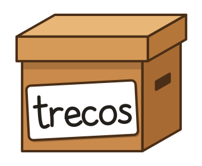

# Trecos

[](https://github.com/vcasadei/trecos/actions/workflows/ci.yml)
[](https://github.com/vcasadei/trecos/actions/workflows/secret-scan.yml)
[](https://trecos.app)
[](https://github.com/vcasadei/trecos/releases)
[](https://github.com/vcasadei/trecos/releases)
[](docs/dev/testing.md)
[](LICENSE)
[](https://github.com/sponsors/vcasadei)

**Trecos: Home Inventory.** A free, source-available, offline-first Android app
(Android 9 and later) that records what you own, where it is physically stored,
and what it is worth, across several houses, with printable QR labels and
optional sync to your own Google Drive. No ads, no account, no server.
Website: [trecos.app](https://trecos.app).

> **Status:** pre-release builds (0.x) on [GitHub Releases](https://github.com/vcasadei/trecos/releases); Google Play closed testing comes next. See the [roadmap](docs/product/roadmap.md).

## Features

- Houses with containers nested to any depth, and items with quantity, unit price, brand, model, serial number and photos
- Two-level categories (several per item) with offline suggestions, and free-form tags
- Move, copy and duplicate, also between houses, and a 30-day trash
- Accent-insensitive search with filters, and "search in this container"
- QR labels: generate, print and scan, including codes from other programs
- English and Portuguese (Brazil); White and pure-black Dark themes
- Optional app lock, database encryption, local backup and Google Drive sync

## Support Trecos

Trecos is free and has no ads. If it helps you, you can support it through
[GitHub Sponsors](https://github.com/sponsors/vcasadei),
[Buy Me a Coffee](https://buymeacoffee.com/vcasadei) or Pix (key and QR code at
[trecos.app](https://trecos.app/pt/#apoie)).

## Documentation

- [Product vision](docs/product/vision.md), [glossary](docs/product/glossary.md) and [decisions](docs/decisions/README.md)
- [Architecture overview](docs/architecture/overview.md)
- [Developer setup on headless Linux](docs/dev/setup-headless-linux.md)
- [All documentation](docs/README.md)

## Build

```sh
./gradlew assembleDebug
```

## Project documents

| Document | Purpose |
|---|---|
| [LICENSE](LICENSE) | PolyForm Noncommercial 1.0.0; third-party components keep their own licenses |
| [COMMERCIAL.md](COMMERCIAL.md) | When commercial use needs a license, and how to ask |
| [CONTRIBUTING.md](CONTRIBUTING.md) | How to contribute |
| [CLA.md](CLA.md) | Contributor License Agreement |
| [CODE_OF_CONDUCT.md](CODE_OF_CONDUCT.md) | Contributor Covenant 2.1 |
| [SECURITY.md](SECURITY.md) | Reporting vulnerabilities privately |
| [PRIVACY.md](PRIVACY.md) | Privacy policy (draft), also at [trecos.app/privacy](https://trecos.app/privacy/) |
| [CHANGELOG.md](CHANGELOG.md) | Release history |

## License

[PolyForm Noncommercial 1.0.0](LICENSE). Free for any noncommercial use; for
commercial use see [COMMERCIAL.md](COMMERCIAL.md).
